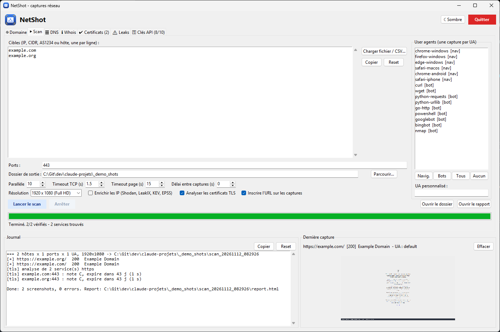

# NetShot

Inventaire et capture d'écran des services web exposés, à partir d'IP, de subnets CIDR, de numéros
d'AS, de noms d'hôte, d'exports CSV (AD, ADCS, CMDB) ou de sous-domaines trouvés par des sources
passives. Les IP trouvées sont enrichies avec des sources gratuites (ports et CVE connus, fuites,
priorisation KEV / EPSS).
Version Python ; même fonctionnement que la version Go (projet `netshot-go`).
`keys.json` (clés API) et `settings.json` (thème) ne sont jamais versionnés (`.gitignore`).



```
netshot/
├── netshot.py            lanceur : ligne de commande
├── netshot_gui.py        lanceur : interface graphique
├── keys.json             clés API (portable, à ne pas partager)
├── requirements.txt
├── core/                 code de l'application
│   ├── scan.py           ligne de commande, scan, captures, rapport
│   ├── gui.py            interface graphique (tkinter), en onglets
│   ├── dns.py            client DNS comme dig (bibliothèque standard), aussi utilisable seul
│   ├── whois.py          whois d'un domaine, d'une IP ou d'un AS (RDAP + port 43), aussi utilisable seul
│   ├── tls.py            analyse TLS et certificats comme sslscan (bibliothèque standard), aussi utilisable seul
│   ├── sources.py        clés API, sources passives de sous-domaines, plages d'AS, import CSV
│   ├── enrich.py         enrichissement des IP (DNS inverse, InternetDB, LeakIX, KEV, EPSS)
│   ├── theme.py          thème clair / sombre de l'interface
│   └── leakcheck.py      fuites de données (LeakCheck Pro API v2), onglet Leaks
├── assets/               icon.png, subdomains.txt (dictionnaire DNS)
├── examples/             targets.example.txt
└── screenshots/          sorties de l'interface graphique
```

Les commandes se lancent depuis le dossier `netshot`.

## Installation

Prérequis : Python 3.9 ou plus récent. Les scripts créent un environnement isolé `.venv` dans le
dossier (le Python du système n'est pas modifié), installent Playwright, téléchargent Chromium
(environ 150 Mo), vérifient l'installation et écrivent deux lanceurs. Les relancer met à jour.

Windows (PowerShell) :

```powershell
powershell -ExecutionPolicy Bypass -File install.ps1
powershell -ExecutionPolicy Bypass -File install.ps1 -Proxy http://proxy.entreprise.local:8080
```

Puis double-clic sur `netshot_gui.cmd`, ou `.\netshot.cmd 192.168.1.0/24` en ligne de commande.

Linux :

```bash
./install.sh            # Debian/Ubuntu : sudo apt install python3-venv python3-tk avant
./install.sh --deps     # installe aussi les bibliothèques système de Chromium (sudo)
./install.sh --proxy http://proxy.entreprise.local:8080
```

Puis `./netshot_gui.sh`, ou `./netshot.sh 192.168.1.0/24`. Option `--recreate` (Linux) ou
`-Recreate` (Windows) : repartir d'un environnement neuf.

Installation à la main, sans les scripts :

```bash
pip install -r requirements.txt
python -m playwright install chromium
```

## Utilisation

```bash
python netshot.py 192.168.1.0/24
python netshot.py -f examples/targets.example.txt -p 80,443,8080,8443 -o captures
```

Fichier de cibles : une cible par ligne, `#` pour les commentaires (voir `examples/targets.example.txt`).

### Limite de débit

`-d 2` : au plus un chargement de page toutes les 2 secondes, tous threads confondus.
Les tests de port TCP restent parallèles.

### User agents

Une capture par user agent, pour voir si un site répond différemment selon le visiteur.

```bash
python netshot.py --list-ua                       # liste des UA intégrés
python netshot.py 10.0.0.0/24 --ua chrome-windows --ua curl --ua wget
python netshot.py 10.0.0.0/24 --ua browsers --ua bots   # ou --ua all
python netshot.py 10.0.0.5 --ua "MonScanner/1.0"        # UA personnalisé
```

- Navigateurs : chrome-windows, firefox-windows, edge-windows, safari-macos, chrome-android, safari-iphone.
- Bots / outils : curl, wget, python-requests, python-urllib, go-http, powershell, googlebot, bingbot, nmap.

Le rapport regroupe les captures par `hôte:port` et signale en orange les services dont la réponse
change selon l'UA (code HTTP, titre, redirection, échec, ou taille de page qui varie de plus de 20 %).
Une case à cocher n'affiche que ces services.

Limite : seul l'en-tête `User-Agent` change. La page reste chargée par Chromium, qui envoie ses
autres en-têtes (`Accept`, `sec-ch-ua`…) et exécute le JavaScript. Un vrai `curl` peut donc obtenir
une réponse différente.

### Sources passives de sous-domaines

```bash
python netshot.py --ct exemple.fr                       # ajoute les sous-domaines aux cibles
python netshot.py --ct exemple.fr --ct-private          # seulement ceux qui pointent vers une IP privée
python netshot.py --ct exemple.fr --ct-only > noms.txt  # liste seulement, sans scan
python netshot.py --ct exemple.fr --ct-sources all      # toutes les sources utilisables
python netshot.py --list-sources                        # sources et clés configurées
```

| Source | Clé | Par défaut | Remarque |
|---|---|---|---|
| crt.name | non | oui | logs CT + historique, le plus complet. 100 requêtes/jour/IP. Domaine racine uniquement |
| Cert Spotter | optionnelle | oui | logs CT. Petit quota sans clé |
| HackerTarget | optionnelle | oui | DNS passif. 50 requêtes/jour sans clé |
| urlscan.io | optionnelle | oui | sites scannés par urlscan |
| VirusTotal | **requise** | oui si clé | DNS passif. 4 requêtes/minute : 4 pages max, espacées de 16 s |
| DNSDumpster | **requise** | oui si clé | enregistrements DNS |
| DomScan | **requise** | oui si clé | logs CT. 1 000 crédits/mois gratuits, 4-5 par page de 500 noms (3 pages max) |
| ViewDNS | **requise** | oui si clé | index ViewDNS. 250 requêtes d'essai puis payant ; 1 requête par page de 1 000 noms (2 pages max) |
| crt.sh | non | non | logs CT, souvent lent ou surchargé |
| Wayback Machine | non | non | anciennes URL archivées. Lent : 6 000 URL max, résultat partiel |
| Shodan | **requise** | oui si clé | noms vus par les scans Shodan. 1 crédit de requête par domaine |
| Dictionnaire DNS | non | non | **actif** : force brute DNS avec les 1 000 noms de `assets/subdomains.txt` ou `--wordlist fichier`, avec détection des wildcards |

Les sources sont interrogées en parallèle. Seul le nom de domaine leur est envoyé, via le proxy
système de Windows s'il y en a un. Par défaut, seuls les noms qui résolvent encore dans le DNS sont gardés.
`--ct-only` ne demande pas Playwright.

### Clés API

Comptes gratuits. Les clés sont dans **`keys.json` à la racine du dossier** (à côté de `netshot.py`).
S'il manque au lancement, il est créé : copie de l'ancien `%APPDATA%\netshot\keys.json` s'il existe
(laissé en place), sinon modèle vide. Un `keys.json` existant n'est jamais écrasé. Fichier en clair,
exclu de git : ne pas partager un dossier qui le contient.
Saisie : onglet « Clés API » de l'interface, ou :

```bash
python netshot.py --key domscan=XXXX --key leakix=YYYY --save-keys
```

Une variable `NETSHOT_KEY_<SOURCE>` (ex. `NETSHOT_KEY_DOMSCAN`) remplace la clé du fichier.

### Plages d'un AS et import CSV

- Une cible `AS1234` est remplacée par les plages IPv4 annoncées par l'AS (RIPEstat, sans clé).
- `-f` et le bouton « Charger fichier / CSV » acceptent un export CSV (`,` ou `;`) : les colonnes
  DNSHostName, Common Name, Subject Alternative Name, FQDN, IPv4Address… sont lues.

```powershell
Get-ADComputer -Filter * -Properties DNSHostName,IPv4Address | Select DNSHostName,IPv4Address | Export-Csv ad.csv -NoTypeInformation
certutil -view -restrict "Disposition=20" -out "CommonName,SAN" csv > adcs.csv
```

### DNS d'un domaine (comme dig)

```bash
python netshot.py --dns exemple.fr                      # résolveurs du système
python netshot.py --dns exemple.fr --dns-server 1.1.1.1
python -m core.dns exemple.fr 1.1.1.1                  # le module seul
```

Une requête ANY est tentée (souvent refusée, RFC 8482), puis chaque type est interrogé un par un :
A, AAAA, CNAME, NS, SOA, MX, TXT, CAA, DS, DNSKEY, HTTPS, et les noms utiles (`www`, `_dmarc`,
`_mta-sts`, `_smtp._tls`, BIMI, SRV Microsoft 365 et Active Directory). Constats : SPF, DMARC, CAA,
DNSSEC, MTA-STS, AD visible. Les serveurs du système sont lus dans le registre Windows
(ou `/etc/resolv.conf`).

### Whois d'un domaine, d'une IP ou d'un AS

```bash
python netshot.py --whois exemple.fr --whois 8.8.8.8 --whois AS3215   # puis quitte
python -m core.whois exemple.fr                                       # le module seul
```

Deux sources en parallèle : **RDAP** (registre officiel, JSON en HTTPS, serveur trouvé par les
fichiers d'amorçage de l'IANA, passe par le proxy) pour le tableau (registrar, titulaire, contacts,
abuse, dates, statut, serveurs de noms, DNSSEC, plage et CIDR d'une IP), et **WHOIS port 43** pour
le texte brut (renvoi IANA, puis registre, puis registrar pour .com ; souvent filtré en entreprise).
Un sous-domaine est cherché sous son domaine enregistré. Constats pour un domaine : expiration
proche, verrou de transfert, verrou du registre, DNSSEC, titulaire masqué. Dans l'interface :
onglet **ℹ Whois**.

### Certificats et configuration TLS (comme sslscan)

```bash
python netshot.py --tls exemple.fr --tls intranet:8443   # puis quitte
python netshot.py 10.0.0.0/24 --tls-scan                 # scan, puis analyse de chaque service https
python -m core.tls exemple.fr                           # le module seul
```

Mêmes contrôles et même note (A+ à F) que la version Go : versions SSLv3 à TLS 1.3 et 80 + 5 suites
testées une par une avec des ClientHello construits à la main, **PQC** (X25519MLKEM768 : proposé seul
sans part de clé, un serveur compatible le redemande), certificat décodé par un petit lecteur DER
(sujet, SAN, émetteur, dates, clé, signature, série, SHA-256, chaîne, OCSP, Must-Staple, SCT),
confiance vérifiée avec le magasin Windows, ALPN et HSTS. Résultats : `certificates.csv` et section
« Certificats et TLS » du rapport. Dans l'interface : onglet **Certificats**.

Limite de la version Python : avec un serveur uniquement TLS 1.3, la chaîne se limite au certificat
du serveur (Python 3.10 ne donne pas les intermédiaires).

### Enrichissement des IP

Après le scan : DNS inverse, Shodan (avec clé : organisation, ASN, pays, OS, service par port avec
version et titre, CVE ; sans clé : InternetDB gratuit avec ports, CPE et CVE), LeakIX (clé gratuite),
CISA KEV (CVE exploitées, en rouge) et EPSS (tri). Seules les IP **publiques** sont envoyées à
Shodan et LeakIX. Résultat : tableau « Exposition » en tête du rapport, ligne de synthèse sous chaque
service, et `exposure.csv`. Désactivable avec `--no-enrich` ou la case de l'interface.

## Interface graphique

```bash
python netshot_gui.py
```

Onglets, dans l'ordre du déroulé : **◎ Domaine** (ouvert au démarrage : sources passives, celles à clé
grisées tant que la clé manque, liste des sous-domaines trouvés), **▶ Scan** (cibles, options, user
agents, lancement, case « Analyser les certificats TLS »), **☰ DNS** (enregistrements comme dig, constats, ajout des hôtes aux cibles, copie au format
dig), **ℹ Whois** (propriétaire d'un domaine, d'une IP ou d'un AS, constats, texte WHOIS brut ;
toute la hauteur de la fenêtre, journal et aperçu masqués),
**✔ Certificats** (analyse TLS, détail au clic), **⚠ Leaks** (fuites de données LeakCheck) et
**⚿ Clés API**. Bouton **☾ Sombre / ☀ Clair** en haut à droite : thème sombre ou clair, choix gardé dans
`settings.json` (sans choix enregistré, le réglage de Windows « mode sombre des applications » est suivi). Les icônes sont des symboles
simples : Tk 8.6 n'affiche pas les emojis couleur. Boutons **Copier** et **Reset**
sur les zones de texte, les tableaux et le journal. Journal et aperçu
toujours visibles en bas. Dans l'onglet Scan : saisie ou chargement des cibles (texte, CSV, `AS1234`),
case « Enrichir les IP », choix des ports, du dossier de sortie, du délai entre captures et de la résolution
(1366x768, 1920x1080 par défaut, 2560x1440, 4K, mobile), sélection des user agents
(Navig. / Bots / Tous / Aucun + UA personnalisé), barre de progression, journal (3 000 dernières
lignes), aperçu de la dernière capture (clic = ouvrir en grand, **Effacer** pour le vider ; le
**Reset** du journal vide aussi l'aperçu, le fichier PNG reste dans le dossier), boutons Arrêter, Ouvrir le dossier,
Ouvrir le rapport et Quitter. Chaque scan crée un sous-dossier `scan_<date>` dans le dossier de
sortie (par défaut `netshot\screenshots\`).

## Options

| Option | Rôle | Défaut |
|---|---|---|
| `-f FILE` | fichier de cibles : liste ou export CSV (répétable) | - |
| `-p PORTS` | ports, ex. `80,443,8000-8010` | `80,443,8000,8080,8443` |
| `-o DIR` | dossier de sortie | `screenshots_<date>` |
| `-c N` | tests en parallèle | `10` |
| `--connect-timeout` | délai TCP (s) | `1.5` |
| `--page-timeout` | délai chargement page (s) | `15` |
| `-d`, `--delay` | secondes minimum entre deux captures | `0` |
| `-u`, `--ua` | user agent (répétable) : nom, `browsers`, `bots`, `all` ou chaîne libre | UA Chromium |
| `--list-ua` | affiche les UA intégrés | - |
| `--ct DOMAINE` | ajoute les sous-domaines trouvés par les sources passives (répétable) | - |
| `--ct-sources` | `default`, `all`, ou une liste (voir `--list-sources`) | `default` |
| `--key SOURCE=CLÉ` | clé API d'un service (répétable) | fichier de clés |
| `--save-keys` | enregistre les `--key` | - |
| `--list-sources` | liste les sources et les clés configurées | - |
| `--no-enrich` | désactive l'enrichissement des IP | enrichissement actif |
| `--no-label` | n'inscrit pas hôte:port, URL, code HTTP et date en bas des captures | bandeau inscrit |
| `--dns DOMAINE` | enregistrements DNS du domaine (comme dig) puis quitte | - |
| `--dns-server` | serveur DNS pour `--dns` | résolveurs du système |
| `--tls HÔTE[:PORT]` | analyse TLS et certificat, puis quitte (répétable) | port 443 |
| `--tls-scan` | après le scan, analyse TLS de chaque service https | non |
| `--ct-all` | garde aussi les noms qui ne résolvent plus | non |
| `--ct-private` | garde seulement les noms qui résolvent vers une IP privée | non |
| `--ct-only` | affiche les noms trouvés et quitte | - |
| `--width` / `--height` | taille de la fenêtre de capture | `1920x1080` |
| `--max-hosts` | limite d'adresses | `65536` |

## Résultats

Le dossier de sortie contient :

- un PNG par service et par user agent : `<hôte>_<port>_<http|https>[_<ua>].png` ;
- `report.html` : captures groupées par `hôte:port`, avec les différences entre UA signalées ;
- `results.csv` : host, port, ua, url, status, title, final_url, size, file, error ;
- avec l'enrichissement : tableau « Exposition » en tête du rapport et `exposure.csv`.

Le cache HTTP est désactivé pour que chaque UA reçoive une réponse fraîche. Quand un service
ne répond ni en http ni en https, l'erreur des deux essais est notée (`http: … | https: …`).

À utiliser uniquement sur des réseaux et des domaines que tu as l'autorisation de scanner.
