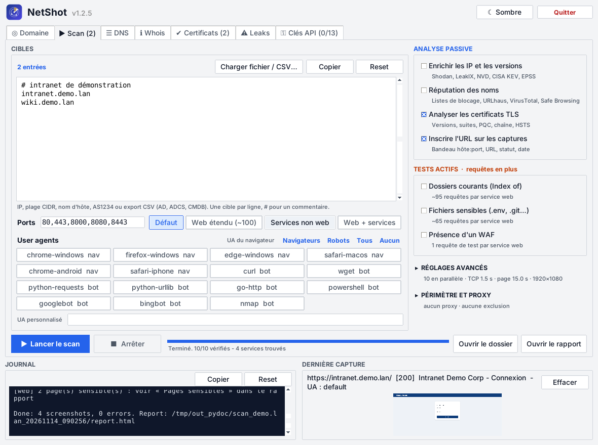
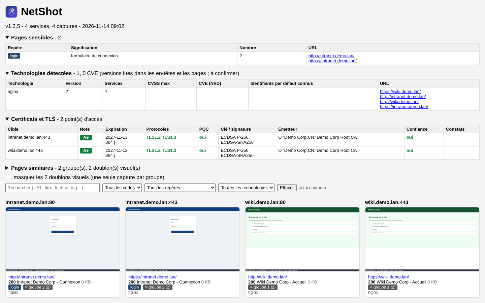

# NetShot

Inventaire et capture d'écran des services web exposés, à partir d'IP, de subnets CIDR, de numéros
d'AS, de noms d'hôte, d'exports CSV (AD, ADCS, CMDB) ou de sous-domaines trouvés par des sources
passives. Les IP trouvées sont enrichies avec des sources gratuites (ports et CVE connus, fuites,
priorisation KEV / EPSS).
Version Python ; même fonctionnement que la version Go (projet `netshot-go`).
`keys.json` (clés API) et `settings.json` (thème) ne sont jamais versionnés (`.gitignore`).





```
netshot/
├── netshot.py            lanceur : ligne de commande
├── netshot_gui.py        lanceur : interface graphique
├── keys.json             clés API (portable, à ne pas partager)
├── requirements.txt
├── core/                 code de l'application
│   ├── scan.py           ligne de commande, scan, captures, rapport
│   ├── gui.py            interface graphique (tkinter), en onglets
│   ├── dns.py            client DNS comme dig (bibliothèque standard), aussi utilisable seul
│   ├── whois.py          whois d'un domaine, d'une IP ou d'un AS (RDAP + port 43), aussi utilisable seul
│   ├── tls.py            analyse TLS et certificats comme sslscan (bibliothèque standard), aussi utilisable seul
│   ├── sources.py        clés API, sources passives de sous-domaines, plages d'AS, import CSV
│   ├── enrich.py         enrichissement des IP (DNS inverse, InternetDB, LeakIX, KEV, EPSS)
│   ├── theme.py          thème clair / sombre de l'interface
│   ├── leakcheck.py      fuites de données (LeakCheck Pro API v2), onglet Leaks
│   ├── pagecheck.py      contenu mixte, SRI, traqueurs, WAF (passif et --waf-probe)
│   └── reputation.py     réputation des noms : résolveurs filtrants, URLhaus
├── assets/               icon.png, icon-32.png (logo radar), subdomains.txt (dictionnaire DNS), dirs.txt (dossiers courants), files.txt (fichiers sensibles)
├── examples/             targets.example.txt
└── screenshots/          sorties de l'interface graphique
```

Les commandes se lancent depuis le dossier `netshot`.

## 📦 Installation

Prérequis : Python 3.9 ou plus récent. Les scripts créent un environnement isolé `.venv` dans le
dossier (le Python du système n'est pas modifié), installent Playwright, téléchargent Chromium
(environ 150 Mo), vérifient l'installation et écrivent deux lanceurs. Les relancer met à jour.

Windows (PowerShell) :

```powershell
powershell -ExecutionPolicy Bypass -File install.ps1
powershell -ExecutionPolicy Bypass -File install.ps1 -Proxy http://proxy.entreprise.local:8080
```

Puis double-clic sur `netshot_gui.cmd`, ou `.\netshot.cmd 192.168.1.0/24` en ligne de commande.

Linux :

```bash
./install.sh            # Debian/Ubuntu : sudo apt install python3-venv python3-tk avant
./install.sh --deps     # installe aussi les bibliothèques système de Chromium (sudo)
./install.sh --proxy http://proxy.entreprise.local:8080
```

Puis `./netshot_gui.sh`, ou `./netshot.sh 192.168.1.0/24`. Option `--recreate` (Linux) ou
`-Recreate` (Windows) : repartir d'un environnement neuf.

Installation à la main, sans les scripts :

```bash
pip install -r requirements.txt
python -m playwright install chromium
```

## 🚀 Utilisation

```bash
python netshot.py 192.168.1.0/24
python netshot.py -f examples/targets.example.txt -p 80,443,8080,8443 -o captures
```

Fichier de cibles : une cible par ligne, `#` pour les commentaires (voir `examples/targets.example.txt`).

### ⏱️ Limite de débit

`-d 2` : au plus un chargement de page toutes les 2 secondes, tous threads confondus.
Les tests de port TCP restent parallèles.

### 🕵️ User agents

Une capture par user agent, pour voir si un site répond différemment selon le visiteur.

```bash
python netshot.py --list-ua                       # liste des UA intégrés
python netshot.py 10.0.0.0/24 --ua chrome-windows --ua curl --ua wget
python netshot.py 10.0.0.0/24 --ua browsers --ua bots   # ou --ua all
python netshot.py 10.0.0.5 --ua "MonScanner/1.0"        # UA personnalisé
```

- Navigateurs : chrome-windows, firefox-windows, edge-windows, safari-macos, chrome-android, safari-iphone.
- Bots / outils : curl, wget, python-requests, python-urllib, go-http, powershell, googlebot, bingbot, nmap.

Le rapport regroupe les captures par `hôte:port` et signale en orange les services dont la réponse
change selon l'UA (code HTTP, titre, redirection, échec, ou taille de page qui varie de plus de 20 %).
Une case à cocher n'affiche que ces services.

Limite : seul l'en-tête `User-Agent` change. La page reste chargée par Chromium, qui envoie ses
autres en-têtes (`Accept`, `sec-ch-ua`…) et exécute le JavaScript. Un vrai `curl` peut donc obtenir
une réponse différente.

### 🔎 Sources passives de sous-domaines

```bash
python netshot.py --ct exemple.fr                       # ajoute les sous-domaines aux cibles
python netshot.py --ct exemple.fr --ct-private          # seulement ceux qui pointent vers une IP privée
python netshot.py --ct exemple.fr --ct-only > noms.txt  # liste seulement, sans scan
python netshot.py --ct exemple.fr --ct-sources all      # toutes les sources utilisables
python netshot.py --list-sources                        # sources et clés configurées
```

| Source | Clé | Par défaut | Remarque |
|---|---|---|---|
| crt.name | non | oui | logs CT + historique, le plus complet. 100 requêtes/jour/IP. Domaine racine uniquement |
| Cert Spotter | optionnelle | oui | logs CT. Petit quota sans clé |
| HackerTarget | optionnelle | oui | DNS passif. 50 requêtes/jour sans clé |
| urlscan.io | optionnelle | oui | sites scannés par urlscan |
| VirusTotal | **requise** | oui si clé | DNS passif. 4 requêtes/minute : 4 pages max, espacées de 16 s |
| DNSDumpster | **requise** | oui si clé | enregistrements DNS |
| DomScan | **requise** | oui si clé | logs CT. 1 000 crédits/mois gratuits, 4-5 par page de 500 noms (3 pages max) |
| ViewDNS | **requise** | oui si clé | index ViewDNS. 250 requêtes d'essai puis payant ; 1 requête par page de 1 000 noms (2 pages max) |
| crt.sh | non | non | logs CT, souvent lent ou surchargé |
| Wayback Machine | non | non | anciennes URL archivées. Lent : 6 000 URL max, résultat partiel |
| Shodan | **requise** | oui si clé | noms vus par les scans Shodan. 1 crédit de requête par domaine |
| Dictionnaire DNS | non | non | **actif** : force brute DNS avec les 1 000 noms de `assets/subdomains.txt` ou `--wordlist fichier`, avec détection des wildcards |

Les sources sont interrogées en parallèle. Seul le nom de domaine leur est envoyé, via le proxy
système de Windows s'il y en a un. Par défaut, seuls les noms qui résolvent encore dans le DNS sont gardés.
`--ct-only` ne demande pas Playwright.

### 🔑 Clés API

Comptes gratuits. Les clés sont dans **`keys.json` à la racine du dossier** (à côté de `netshot.py`).
S'il manque au lancement, un modèle vide est créé ; un `keys.json` existant n'est jamais écrasé.
À l'enregistrement, seuls les champs remplis sont modifiés et l'ancien fichier est gardé en
`keys.json.bak`. Fichier en clair, exclu de git : ne pas partager un dossier qui le contient.
Saisie : onglet « Clés API » de l'interface, ou :

```bash
python netshot.py --key domscan=XXXX --key leakix=YYYY --save-keys
```

Une variable `NETSHOT_KEY_<SOURCE>` (ex. `NETSHOT_KEY_DOMSCAN`) remplace la clé du fichier.

Services acceptant une clé : certspotter, hackertarget, urlscan, virustotal, dnsdumpster, domscan,
viewdns, leakix, shodan, leakcheck, nvd, abusech (URLhaus).

### 🌍 Plages d'un AS et import CSV

- Une cible `AS1234` est remplacée par les plages IPv4 annoncées par l'AS (RIPEstat, sans clé).
- `-f` et le bouton « Charger fichier / CSV » acceptent un export CSV (`,` ou `;`) : les colonnes
  DNSHostName, Common Name, Subject Alternative Name, FQDN, IPv4Address… sont lues.

```powershell
Get-ADComputer -Filter * -Properties DNSHostName,IPv4Address | Select DNSHostName,IPv4Address | Export-Csv ad.csv -NoTypeInformation
certutil -view -restrict "Disposition=20" -out "CommonName,SAN" csv > adcs.csv
```

### 🧭 DNS d'un domaine (comme dig)

```bash
python netshot.py --dns exemple.fr                      # résolveurs du système
python netshot.py --dns exemple.fr --dns-server 1.1.1.1
python -m core.dns exemple.fr 1.1.1.1                  # le module seul
```

Une requête ANY est tentée (souvent refusée, RFC 8482), puis chaque type est interrogé un par un :
A, AAAA, CNAME, NS, SOA, MX, TXT, CAA, DS, DNSKEY, HTTPS, et les noms utiles (`www`, `_dmarc`,
`_mta-sts`, `_smtp._tls`, BIMI, SRV Microsoft 365 et Active Directory, 32 sélecteurs DKIM courants).
Constats : SPF, DMARC, DKIM (sélecteurs trouvés, clé révoquée), CAA, DNSSEC, MTA-STS, AD visible.
Le sélecteur DKIM réel peut être un autre mot : « DKIM non trouvé » ne prouve pas son absence. Les serveurs du système sont lus dans le registre Windows
(ou `/etc/resolv.conf`).

### 🪪 Whois d'un domaine, d'une IP ou d'un AS

```bash
python netshot.py --whois exemple.fr --whois 8.8.8.8 --whois AS3215   # puis quitte
python -m core.whois exemple.fr                                       # le module seul
```

Deux sources en parallèle : **RDAP** (registre officiel, JSON en HTTPS, serveur trouvé par les
fichiers d'amorçage de l'IANA, passe par le proxy) pour le tableau (registrar, titulaire, contacts,
abuse, dates, statut, serveurs de noms, DNSSEC, plage et CIDR d'une IP), et **WHOIS port 43** pour
le texte brut (renvoi IANA, puis registre, puis registrar pour .com ; souvent filtré en entreprise).
Un sous-domaine est cherché sous son domaine enregistré. Constats pour un domaine : expiration
proche, verrou de transfert, verrou du registre, DNSSEC, titulaire masqué. Dans l'interface :
onglet **ℹ Whois**.

### 🔒 Certificats et configuration TLS (comme sslscan)

```bash
python netshot.py --tls exemple.fr --tls intranet:8443   # puis quitte
python netshot.py 10.0.0.0/24 --tls-scan                 # scan, puis analyse de chaque service https
python -m core.tls exemple.fr                           # le module seul
```

Mêmes contrôles et même note (A+ à F) que la version Go : versions SSLv3 à TLS 1.3 et 80 + 5 suites
testées une par une avec des ClientHello construits à la main, **PQC** (X25519MLKEM768 : proposé seul
sans part de clé, un serveur compatible le redemande), certificat décodé par un petit lecteur DER
(sujet, SAN, émetteur, dates, clé, signature, série, SHA-256, chaîne, OCSP, Must-Staple, SCT),
confiance vérifiée avec le magasin Windows, ALPN et HSTS. Résultats : `certificates.csv` et section
« Certificats et TLS » du rapport. Dans l'interface : onglet **Certificats**.

Limite de la version Python : avec un serveur uniquement TLS 1.3, la chaîne se limite au certificat
du serveur (Python 3.10 ne donne pas les intermédiaires).

### 🕳️ Reconnaissance approfondie

| Analyse | Requêtes en plus | Ce qui est relevé |
|---|---|---|
| **Fichiers sensibles** (`--files`, désactivé par défaut) | ~65 par service web | `.env`, `.git/HEAD`, `.svn`, `.DS_Store`, `.htpasswd`, `web.config.bak`, `wp-config.php.bak`, clés SSH, sauvegardes `.zip` / `.sql`, `phpinfo`, `server-status`, Spring `actuator/env`, `elmah.axd`, Swagger… Chaque réponse doit contenir la signature du fichier : une page 404 personnalisée ne donne pas de faux positif. Seuls les 64 premiers Ko sont lus. Liste modifiable : `assets/files.txt` (chemin, gravité, signature) ou `--files-wordlist fichier` |
| **JavaScript** | aucune | scripts du site chargés par la page et scripts en ligne : chemins d'API (`/api/…`, `/internal/…`), URL internes (IP privées, `.local`, `.corp`…), secrets (clés AWS, Google, Slack, GitHub, Stripe, JWT, chaînes de connexion, `client_secret`…). Les secrets sont **masqués** partout (`AKIA…MPLE`) avec le fichier et la ligne pour vérifier |
| **robots.txt, sitemap.xml, security.txt** | 3 par service web | chemins que le site demande de ne pas indexer (liens cliquables), nombre d'URL du sitemap, contacts sécurité |
| **Prise de contrôle de sous-domaine** | DNS seulement | nom dont le CNAME pointe vers un service cloud qui n'existe plus (S3, Azure, GitHub Pages, Heroku, Shopify, Fastly… : NXDOMAIN ou page « ressource inexistante ») |
| **Services non web** | 1 ou 2 connexions par port ouvert sans page web | bannière (SSH, FTP, SMTP, POP, IMAP, MySQL / MariaDB, Redis, VNC, Telnet, RDP) ; la version part dans les technologies, donc dans la recherche de CVE |
| **Identifiants par défaut** | aucune | rappel des identifiants par défaut connus de chaque techno trouvée (Tomcat, Grafana, RabbitMQ, NetScaler, BIG-IP…). **Rien n'est essayé** : c'est une liste à vérifier à la main, dans le cadre autorisé |

Les sections correspondantes sont en tête du rapport, et dans les onglets de `results.xlsx`.
Seuls les fichiers sensibles sont désactivés par défaut. Le reste se coupe avec `--no-analyze`.

**Préréglages de ports** : `-p web` (une centaine de ports web : 81, 3000, 5000, 8081, 8888, 9090,
10000…), `-p services` (SSH, FTP, Telnet, SMTP, POP, IMAP, LDAP, bases de données, RDP, VNC, Redis,
MongoDB…), mélangeables : `-p web,services,8443`. Dans l'interface : bouton **Préréglages ▾** à côté
des ports.

```bash
python netshot.py 10.0.0.0/24 -p web,services --files
```

### 🎯 Périmètre et proxy

**Hors périmètre** : les cibles exclues par contrat ne sont jamais testées. IP, plage CIDR, nom
d'hôte ou `*.domaine` (tous les sous-domaines). Un nom qui pointe vers une plage exclue est exclu
aussi. Les cibles retirées sont listées dans le journal.

```bash
python netshot.py 10.0.0.0/16 --exclude "10.0.5.0/24, prod-db.exemple.fr, *.partenaire.fr"
python netshot.py -f cibles.txt --exclude-file hors_perimetre.txt
```

**Proxy** : `--proxy http://127.0.0.1:8080` (Burp, ZAP : tout le trafic web est tracé) ou
`--proxy socks5://hôte:1080` (rebond). Les pages, favicons et dossiers (`--dirs`) passent par le
proxy. Le test des ports passe par le proxy SOCKS5 ; avec un proxy HTTP il reste direct (la réponse
d'un proxy HTTP ne dit rien de l'état du port). L'analyse TLS, l'enrichissement et NVD restent
directs. Proxy HTTP avec mot de passe : `http://user:motdepasse@hôte:port` ; Chromium n'accepte pas
de mot de passe en SOCKS5.

Dans l'interface : champs « Proxy » et « Hors périmètre » (bouton **Fichier…** pour charger une
liste) sous les options du Scan.

### 🛰️ Enrichissement des IP

Après le scan : DNS inverse, Shodan (avec clé : organisation, ASN, pays, OS, service par port avec
version et titre, CVE ; sans clé : InternetDB gratuit avec ports, CPE et CVE), LeakIX (clé gratuite),
CISA KEV (CVE exploitées, en rouge) et EPSS (tri). Seules les IP **publiques** sont envoyées à
Shodan et LeakIX. Résultat : tableau « Exposition » en tête du rapport, ligne de synthèse sous chaque
service, et `exposure.csv`. Désactivable avec `--no-enrich` ou la case de l'interface.

### 🚦 Réputation des noms (listes de blocage, malware, phishing)

Chaque nom d'hôte **public** scanné est vérifié (un nom qui pointe vers une IP
interne n'est jamais envoyé). Désactivable avec `--no-reputation` (ou `--no-enrich`) ou la case
« Réputation des noms » de l'interface :

| Source | Clé | Ce qui est relevé |
|---|---|---|
| **Résolveurs DNS filtrants** | aucune | Quad9 (malware, phishing), Cloudflare 1.1.1.2 (malware), OpenDNS (phishing), AdGuard DNS (publicité, traqueurs) : un nom qui résout normalement (1.1.1.1) mais que ces résolveurs bloquent (NXDOMAIN, `0.0.0.0`, page de blocage) est signalé. Le port 53 sortant doit être ouvert ; sinon le journal l'indique |
| **URLhaus** (abuse.ch) | `abusech`, gratuite | URL malveillantes connues sur le nom (et combien sont encore en ligne), présence dans Spamhaus DBL et SURBL |

Niveau : **critique** (URL malveillante encore en ligne selon URLhaus), **haute** (bloqué par un
résolveur de sécurité, ou nom connu d'URLhaus), **info** (bloqué seulement par AdGuard, donc
publicité ou traqueur). Sans clé `abusech`, seuls les résolveurs filtrants sont interrogés.
Section « Réputation » en tête du rapport, `reputation.csv`, onglet « Réputation » de `results.xlsx`.

### 🔬 Analyse des pages

Pendant la capture, NetShot lit ce que chaque page révèle, sans scan supplémentaire (seule requête en
plus : le favicon). Désactivable avec `--no-analyze`.

| Analyse | Ce qui est relevé |
|---|---|
| **Technologies** | serveur, langage, CMS, framework, équipement (FortiGate, NetScaler, BIG-IP…) et version, lus dans les en-têtes (`Server`, `X-Powered-By`…), les cookies, la balise `generator`, les scripts et le HTML. Avec l'enrichissement, les CVE de chaque version sont cherchées dans **NVD** puis classées avec CISA KEV et EPSS. Seuls le produit et la version partent vers NVD, jamais une adresse. Sans clé NVD : ~7 s par version ; avec la clé gratuite `nvd` : moins d'une seconde |
| **Pages sensibles** | `index-of` (liste de fichiers : « Index of / », « Directory listing for », IIS), `debug` (trace d'erreur, debug Django / Werkzeug, phpinfo), `default` (page par défaut Apache, IIS, nginx, Tomcat…), `admin` (interface d'administration), `login` (champ mot de passe), `auth-http` (401) |
| **Favicon** | hash MurmurHash3 identique au filtre Shodan `http.favicon.hash`, avec un lien de recherche Shodan |
| **Pages similaires** | hash perceptuel de chaque capture : les pages identiques sont regroupées et une case du rapport masque les doublons |
| **En-têtes de sécurité** | HSTS, CSP, anti-clickjacking, `nosniff`, `Referrer-Policy` absents, version divulguée, cookies sans `Secure` / `HttpOnly` / `SameSite`, mot de passe saisi en HTTP clair |
| **Contenu mixte et SRI** | ressources (scripts, styles, images, iframes…) et formulaires en `http://` sur une page HTTPS ; scripts et feuilles de style d'un autre site chargés sans attribut `integrity` (SRI). Lus dans la page déjà chargée, sans requête de plus |
| **Traqueurs et tiers** | ~80 services connus : mesure d'audience (Google Analytics, Matomo Cloud, AT Internet…), publicité, pixels des réseaux sociaux, analyse comportementale (Hotjar, Clarity…), bannières de consentement, Google Fonts, chat, monitoring ; plus la liste des hôtes tiers appelés par la page. Utile pour un contrôle RGPD |
| **WAF / CDN de protection** | Cloudflare, Akamai, Imperva, Sucuri, F5 ASM, AWS WAF / CloudFront, Azure Front Door / Application Gateway, FortiWeb, Barracuda, NetScaler AppFirewall, ModSecurity, Fastly, DDoS-Guard… lus dans les en-têtes et les cookies. Avec `--waf-probe` (désactivé par défaut, test **actif**, case « Tester la présence d'un WAF » dans l'interface) : une requête avec une chaîne d'attaque inoffensive dans l'URL, comparée à la page normale ; un code 403 / 406… ou une page de blocage confirme le filtrage et nomme souvent le produit |

Les versions lues dans les en-têtes sont indicatives : un serveur peut masquer ou mentir sur sa
version, et une distribution peut corriger une faille sans changer le numéro (rétroportage).

**Dossiers courants** (option, désactivée par défaut) : sur chaque service web trouvé, NetShot teste
les ~95 dossiers de `assets/dirs.txt` (`backup/`, `uploads/`, `logs/`, `.git/`…) avec une requête
légère chacun, et capture ceux qui affichent une liste de fichiers (tag `index-of`). Comme le
dictionnaire DNS, la liste se modifie ou se remplace par `--dirs-wordlist fichier` (un chemin par
ligne). C'est une démarche **active** : ~95 requêtes de plus par service, soumises à `--delay`.

```bash
python netshot.py 10.0.0.0/24 --dirs
python netshot.py -f cibles.txt --dirs-wordlist mes_dossiers.txt
```

Dans l'interface : case « Tester les dossiers courants (Index of) ». Une page sensible n'est jamais
masquée par la case « masquer les doublons visuels ».

## 🖥️ Interface graphique

```bash
python netshot_gui.py
```

Ou double-clic sur `netshot_gui.cmd` (créé par le script d'installation). La fenêtre s'ouvre
centrée sur l'écran.

#### 🗂️ Onglets

Dans l'ordre du déroulé d'une reconnaissance :

| Onglet | Rôle |
|---|---|
| **◎ Domaine** | Ouvert au démarrage. Recherche de sous-domaines dans les sources passives ; les sources à clé restent grisées tant que la clé manque. Les noms trouvés sont ajoutés aux cibles du Scan. |
| **▶ Scan** | Cibles, options, user agents, lancement des captures. |
| **☰ DNS** | Enregistrements d'un domaine (comme dig), constats, ajout des hôtes aux cibles, copie au format dig. |
| **ℹ Whois** | Propriétaire d'un domaine, d'une IP ou d'un AS : tableau à gauche, texte WHOIS brut à droite, constats. L'onglet occupe toute la hauteur de la fenêtre. |
| **✔ Certificats** | Analyse TLS des services https trouvés, détail au clic. |
| **⚠ Leaks** | Fuites de données (LeakCheck, clé requise) : mots de passe masqués par défaut, tri, export CSV. |
| **⚿ Clés API** | Saisie des clés des services gratuits. Seuls les champs remplis sont enregistrés, `-` supprime une clé. |

#### 📸 Onglet Scan

- **Cibles** (à gauche) : saisie (IP, CIDR, `AS1234`, nom d'hôte, une par ligne) ou **Charger un fichier / CSV…**.
  Un compteur indique le nombre d'entrées et une estimation du nombre d'adresses (plages CIDR).
- **Ports** : liste libre ou préréglages en boutons (Défaut, Web étendu, Services non web, Web + services).
- **User agents** : boutons à cocher sous les ports, sélection rapide Navigateurs / Robots / Tous / Aucun,
  UA personnalisé. Aucun coché = UA du navigateur.
- **Analyse passive** (à droite, en bleu) : « Enrichir les IP et les versions », « Réputation des noms »,
  « Analyser les certificats TLS », « Inscrire l'URL sur les captures ».
- **Tests actifs** (en orange, désactivés par défaut, requêtes en plus) : dossiers courants (Index of),
  fichiers sensibles (.env, .git…), présence d'un WAF.
- **Réglages avancés** (replié, avec un résumé) : dossier de sortie, tests en parallèle, timeouts, délai entre
  deux captures, résolution (1366x768, 1920x1080 par défaut, 2560x1440, 4K, mobile).
- **Périmètre et proxy** (replié, avec un résumé) : voir « Périmètre et proxy ».
- **Barre d'action**, toujours visible en bas de l'onglet : Lancer le scan, Arrêter, progression, Ouvrir le
  dossier, Ouvrir le rapport.
- **Journal et Dernière capture** : en bas de la fenêtre, côte à côte (journal à gauche, capture à droite),
  toujours visibles sur tous les onglets sauf Whois.
  Clic sur l'aperçu pour ouvrir l'image, **Effacer** pour le vider (le fichier PNG reste dans le dossier).

Chaque scan crée un sous-dossier `scan_<domaine>_<date>` (ex. `scan_guifort.ovh_20261114_095743`) dans le dossier de sortie
(le domaine commun des noms scannés, ou la cible quand il n'y en a qu'une : `scan_10.0.0.0-24_…` ; sinon `scan_<date>`) (par défaut `netshot\screenshots\`).

#### 🧰 Partout

- **Journal** en bas de chaque onglet, sauf Whois (3 000 dernières lignes). Son bouton **Reset** vide aussi l'aperçu de capture.
- Boutons **Copier** et **Reset** sur les zones de texte, les tableaux et le journal.
- **☾ Sombre / ☀ Clair** en haut à droite. Le choix est gardé dans `settings.json` ; sans choix enregistré,
  le réglage Windows « mode sombre des applications » est suivi.
- Les icônes des onglets sont des symboles simples : Tk 8.6 n'affiche pas les emojis en couleur.

## ⚙️ Options

| Option | Rôle | Défaut |
|---|---|---|
| `-f FILE` | fichier de cibles : liste ou export CSV (répétable) | - |
| `-p PORTS` | ports, ex. `80,443,8000-8010`, ou préréglages `web`, `services`, `default` (mélangeables) | `80,443,8000,8080,8443` |
| `-o DIR` | dossier de sortie | `screenshots_<date>` |
| `-c N` | tests en parallèle | `10` |
| `--connect-timeout` | délai TCP (s) | `1.5` |
| `--page-timeout` | délai chargement page (s) | `15` |
| `-d`, `--delay` | secondes minimum entre deux captures | `0` |
| `-u`, `--ua` | user agent (répétable) : nom, `browsers`, `bots`, `all` ou chaîne libre | UA Chromium |
| `--list-ua` | affiche les UA intégrés | - |
| `-V`, `--version` | affiche la version de NetShot | - |
| `--ct DOMAINE` | ajoute les sous-domaines trouvés par les sources passives (répétable) | - |
| `--ct-sources` | `default`, `all`, ou une liste (voir `--list-sources`) | `default` |
| `--key SOURCE=CLÉ` | clé API d'un service (répétable) | fichier de clés |
| `--save-keys` | enregistre les `--key` | - |
| `--list-sources` | liste les sources et les clés configurées | - |
| `--no-enrich` | désactive l'enrichissement des IP, la recherche des CVE dans NVD et la réputation des noms | enrichissement actif |
| `--no-reputation` | désactive seulement la réputation des noms | réputation active |
| `--no-analyze` | désactive l'analyse des pages (technologies, pages sensibles, en-têtes, favicon, pages similaires) | analyse active |
| `--exclude CIBLES` | cibles hors périmètre : IP, CIDR, nom ou `*.domaine`, séparées par des virgules (répétable) | - |
| `--exclude-file FILE` | fichier de cibles hors périmètre, une par ligne (répétable) | - |
| `--proxy URL` | proxy des pages : `http://hôte:port` ou `socks5://hôte:port` | aucun |
| `--files` | teste les fichiers sensibles de `assets/files.txt` (signature vérifiée) | non |
| `--files-wordlist FILE` | liste de fichiers à la place de `assets/files.txt` (active `--files`) | - |
| `--waf-probe` | une requête de test par service web (chaîne XSS / SQL / `../` inoffensive) pour voir si un WAF bloque | non |
| `--dirs` | teste les dossiers de `assets/dirs.txt` et capture les listes de fichiers trouvées | non |
| `--dirs-wordlist FILE` | liste de dossiers à tester à la place de `assets/dirs.txt` (active `--dirs`) | - |
| `--no-label` | n'inscrit pas hôte:port, URL, code HTTP et date en bas des captures | bandeau inscrit |
| `--dns DOMAINE` | enregistrements DNS du domaine (comme dig) puis quitte | - |
| `--dns-server` | serveur DNS pour `--dns` | résolveurs du système |
| `--tls HÔTE[:PORT]` | analyse TLS et certificat, puis quitte (répétable) | port 443 |
| `--tls-scan` | après le scan, analyse TLS de chaque service https | non |
| `--ct-all` | garde aussi les noms qui ne résolvent plus | non |
| `--ct-private` | garde seulement les noms qui résolvent vers une IP privée | non |
| `--ct-only` | affiche les noms trouvés et quitte | - |
| `--width` / `--height` | taille de la fenêtre de capture | `1920x1080` |
| `--max-hosts` | limite d'adresses | `65536` |

## 📊 Résultats

Le dossier de sortie contient :

- un PNG par service et par user agent : `<hôte>_<port>_<http|https>[_<ua>].png` ;
- `report.html` : captures groupées par `hôte:port`, avec les différences entre UA signalées, et une
  barre de filtres qui reste en haut de l'écran : recherche (URL, titre, techno, tag), code HTTP,
  repère et technologie ;
- `results.csv` : host, port, ua, url, status, title, final_url, size, file, error, tags, tech,
  favicon_hash, header_issues, visual_group, waf, waf_probe, mixed_content, no_sri, trackers,
  third_party_hosts ;
- `technologies.csv` : technologies et versions trouvées, URL concernées, CVE, KEV, EPSS et CVSS max ;
- `results.xlsx` : un onglet par thème (Services, Pages sensibles, Technologies, En-têtes, Fichiers
  exposés, JavaScript, Takeover, Services non web, robots et sitemap, Exposition, WAF / SRI /
  traqueurs, Réputation),
  avec filtres et en-tête figé, prêt pour un suivi des écarts ;
- `results.json` : tout le scan (services, technologies, exposition, TLS, pages similaires) pour un
  autre outil ;
- en tête du rapport : « Réputation », « Pages sensibles », « Technologies détectées », « En-têtes de
  sécurité », « WAF / CDN de protection », « Contenu mixte et SRI », « Traqueurs et tiers » et « Pages
  similaires » ;
- avec l'enrichissement : tableau « Exposition » en tête du rapport, `exposure.csv` et `reputation.csv`.

Le cache HTTP est désactivé pour que chaque UA reçoive une réponse fraîche. Quand un service
ne répond ni en http ni en https, l'erreur des deux essais est notée (`http: … | https: …`).

À utiliser uniquement sur des réseaux et des domaines que tu as l'autorisation de scanner.
